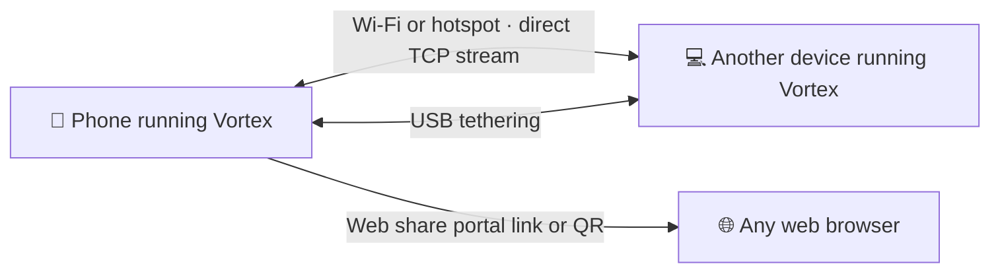

<div align="center">


# Vortex

<a href="https://github.com/darkdevil7773">
  
</a>

**A fast, offline file manager and transfer app for Android and Linux, built with Flutter.**

<br>


[](https://t.me/darkdevil7773)

<br>


</div>

<br>

## Contents

- [Why Vortex](#why-vortex)
- [Features](#features)
- [Screenshots](#screenshots)
- [How it works](#how-it-works)
- [Getting started](#getting-started)
- [Tech stack](#tech-stack)
- [Permissions](#permissions)
- [Building a release](#building-a-release)
- [Roadmap](#roadmap)
- [Contributing](#contributing)
- [License](#license)
- [Author](#author)

<br>

## Why Vortex

Sending a file to another device should not need an internet connection, a cloud account or a cable you cannot find. Vortex turns your phone into a local file hub. It manages the files on the device, and it moves them to a laptop, a tablet or another phone over your own Wi-Fi, a hotspot or a USB cable.

<table>
  <tr>
    <td width="33%" valign="top">
      <h4>📡 Offline first</h4>
      Transfers stay on your local network. No mobile data, no accounts, no cloud.
    </td>
    <td width="33%" valign="top">
      <h4>⚡ Direct and fast</h4>
      Files stream device to device over a direct TCP connection, with live speed and progress.
    </td>
    <td width="33%" valign="top">
      <h4>🌐 Works with anything</h4>
      Other device has no app? Share a link and download from any browser.
    </td>
  </tr>
</table>

<br>

## Features

| | Feature | What it does |
|:-:|---|---|
| 🗂️ | **Smart file management** | Browse internal storage, sort by name, create folders, cut, copy, paste, rename and see details. Select many items at once. |
| 🧩 | **Category views** | Jump straight to Photos, Videos, Audio, Documents, APKs and Archives, with counts on the home screen. |
| 📶 | **Wi-Fi file transfer** | Connect two devices on the same Wi-Fi or hotspot and send files directly. |
| 🔌 | **USB tethering support** | Open tethering settings from the app and transfer over a stable wired link. |
| 🚀 | **Turbo mode** | Use Wi-Fi and USB together for maximum speed. |
| 🔳 | **QR code pairing** | Show your QR code or scan another one to connect instantly. Prefer typing? Enter the IP address and 6-digit token. |
| 🖥️ | **Web share portal** | Turn on the portal, scan the QR code on a computer, then download files or drag and drop to upload. No app needed on the other side. |
| 📊 | **Live transfer panel** | A compact progress bar plus an expanded view with speed graph, size, percentage and a stop button. |
| 💾 | **Storage overview** | Free space, used space and a quick ratio bar on the home screen. |
| ▶️ | **Built-in preview** | Play video and audio, view thumbnails, and open any file with the app of your choice. |

<br>

## Screenshots

<div align="center">
<table>
  <tr>
    <td align="center"><br><sub><b>Home</b></sub></td>
    <td align="center"><br><sub><b>Transfer in progress</b></sub></td>
    <td align="center"><br><sub><b>Transfer details</b></sub></td>
  </tr>
  <tr>
    <td align="center"><br><sub><b>Connect and share</b></sub></td>
    <td align="center"><br><sub><b>Web share portal</b></sub></td>
    <td align="center"><br><sub><b>QR pairing</b></sub></td>
  </tr>
  <tr>
    <td align="center"><br><sub><b>Select and manage</b></sub></td>
    <td align="center"><br><sub><b>APKs</b></sub></td>
    <td align="center"><br><sub><b>About</b></sub></td>
  </tr>
</table>
</div>

<br>

## How it works



**Pair two devices**

1. Open **Connect and share** and pick **Via Wi-Fi**, **Via USB** or **Via both**.
2. On the receiving device, open **My QR**. On the sending device, open **Scan QR** and scan it. You can also use **Manual IP** and type the IP address and the 6-digit token.
3. Choose files and send. Watch speed and progress in the transfer bar, and tap it to expand.

**Share with a device that has no app**

1. Turn on the **Web share portal**.
2. On the other device, scan the QR code or type the shown address into a browser. Both devices must be on the same Wi-Fi or hotspot.
3. Download the files you staged, or drag and drop files to send them back to the phone.

<br>

## Getting started

<details open>
<summary><b>Requirements</b></summary>

<br>

- [Flutter SDK](https://docs.flutter.dev/get-started/install) with Dart `^3.10.1`
- Android Studio or the Android SDK, for Android builds
- A Linux machine with the [Flutter Linux desktop requirements](https://docs.flutter.dev/platform-integration/linux/install-linux/install-linux-from-android), for Linux builds
- A physical Android device is recommended, because camera scanning and tethering need real hardware

</details>

**1. Clone the repository**

```bash
git clone https://github.com/<your-username>/vortex.git
cd vortex
```

**2. Install dependencies**

```bash
flutter pub get
```

**3. Generate launcher icons** (optional, the icon files are already configured)

```bash
dart run flutter_launcher_icons
```

**4. Run the app**

```bash
# Android device or emulator
flutter run

# Linux desktop
flutter run -d linux
```

<br>

## Tech stack

<div align="center">


</div>

<br>

| Area | Package | Used for |
|---|---|---|
| State | [`provider`](https://pub.dev/packages/provider) | App state management |
| Motion | [`flutter_animate`](https://pub.dev/packages/flutter_animate) | UI animations and transitions |
| Storage | [`disk_space_2`](https://pub.dev/packages/disk_space_2) | Free and used space |
| Files | [`path_provider`](https://pub.dev/packages/path_provider), [`open_filex`](https://pub.dev/packages/open_filex) | File locations and opening files |
| Settings | [`shared_preferences`](https://pub.dev/packages/shared_preferences) | Saving preferences |
| Media | [`video_player`](https://pub.dev/packages/video_player), [`chewie`](https://pub.dev/packages/chewie), [`audioplayers`](https://pub.dev/packages/audioplayers), [`video_thumbnail`](https://pub.dev/packages/video_thumbnail) | Video and audio playback, thumbnails |
| Networking | [`web_socket_channel`](https://pub.dev/packages/web_socket_channel), [`network_info_plus`](https://pub.dev/packages/network_info_plus) | Device connections and local network details |
| Pairing | [`qr_flutter`](https://pub.dev/packages/qr_flutter), [`mobile_scanner`](https://pub.dev/packages/mobile_scanner), [`uuid`](https://pub.dev/packages/uuid) | QR codes, scanning, unique IDs |
| Device | [`device_info_plus`](https://pub.dev/packages/device_info_plus), [`permission_handler`](https://pub.dev/packages/permission_handler), [`android_intent_plus`](https://pub.dev/packages/android_intent_plus) | Device name, permissions, opening system settings |
| Formatting | [`intl`](https://pub.dev/packages/intl) | Dates and sizes |

<br>

## Permissions

Vortex asks only for what a file manager and local transfer app needs. The exact list depends on your Android version.

| Permission | Why |
|---|---|
| Storage or media access | Browse, copy, move and share your files |
| Camera | Scan a QR code to pair with another device |
| Local network and Wi-Fi state | Find the device IP address and connect on the same network |

<br>

## Building a release

```bash
# Android APK
flutter build apk --release

# Android App Bundle
flutter build appbundle --release

# Linux
flutter build linux --release
```

The APK is written to `build/app/outputs/flutter-apk/app-release.apk`.

<br>

## Roadmap

- [x] File browser with sorting, selection, cut, copy, paste, rename and details
- [x] Wi-Fi, USB and combined transfer modes
- [x] QR pairing and manual IP with token
- [x] Web share portal for any browser
- [x] Live transfer progress and speed graph
- [ ] Resume interrupted transfers
- [ ] Transfer history
- [ ] Folder transfers
- [ ] Light theme

<br>

## Contributing

Issues and pull requests are welcome.

1. Fork the repository and create a branch: `git checkout -b feature/your-idea`
2. Keep the code formatted and lint-clean: `dart format .` and `flutter analyze`
3. Open a pull request that explains what changed and why

<br>

## License

Vortex is open source software released under the [MIT License](LICENSE). You are free to use, copy, modify and distribute the code, as long as you keep the copyright and license notice.

The Vortex name and logo are not covered by the MIT License. Please do not use them to present a modified version of the app as the official one.

Third-party packages used by Vortex keep their own licenses. You can see them inside the app, or by running `flutter pub deps`.

<br>

## Author

<div align="center">

**Dark** · [@darkdevil7773](https://t.me/darkdevil7773) on Telegram

Made with Flutter and love.

If Vortex is useful to you, a ⭐ on the repository helps a lot.

<br>

<sub>Vortex v1.0.0 · [MIT License](LICENSE)</sub>

</div>